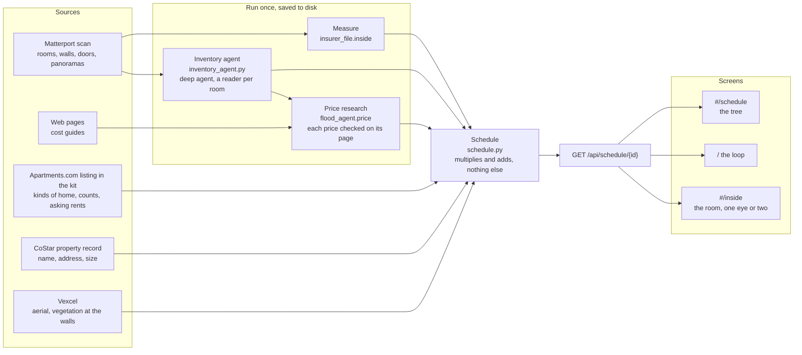
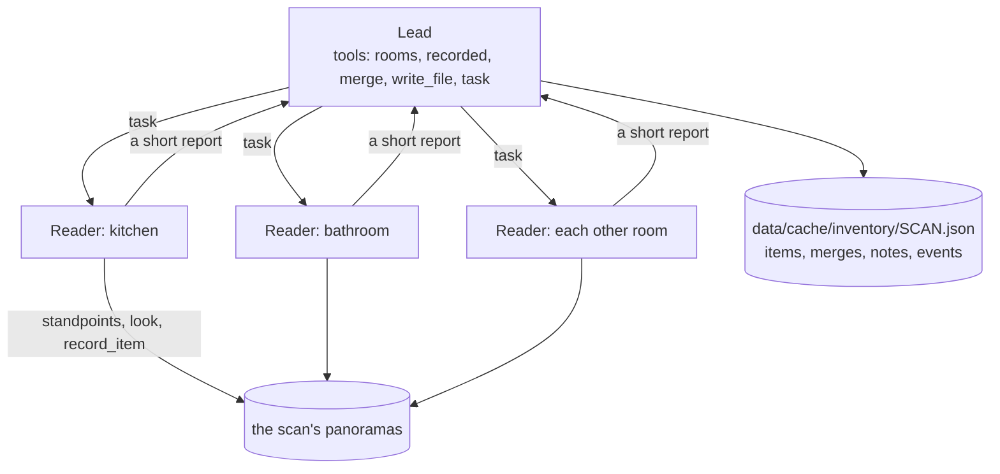

# Brace: architecture

As built on Saturday 14 November 2026, 18:00. The product is in `PRD.md`; the two-minute loop is in
`DEMO_LOOP.md`. Anything not built yet is under "Not built yet" at the end and nowhere else.

**What the system does:** it turns the leasing scan of one apartment home into a priced list of what the owner
would have to replace after a fire, then multiplies that list across the kinds of home the community has.

## The whole thing on one page



Models run only in the middle column, ahead of time. Nothing on a screen waits on a model.

## Where each number comes from

| Number | Source | Code |
| --- | --- | --- |
| Floor area, wall length, ceiling height, door count | Matterport's measurements of the scan | `backend/insurer_file.py` (`inside`), `backend/openings.py` |
| What fit-out is in each room, and how many | The inventory agent, looking at the scan's panoramas | `backend/inventory_agent.py` |
| A price range for each kind of line | A web page, kept only when a fetch of the page finds the price and the sentence | `backend/flood_agent.py` (`price`, `confirm`) |
| Kinds of home, how many of each, asking rents | The community's Apartments.com listing, as it stands in the kit | `backend/portfolio.py` (`floor_plans`, `rent`) |
| Vegetation within 5 ft of each building's walls | Vexcel | the height files, read in `backend/flood.py` (`site`) |
| Every total | Arithmetic in code | `backend/schedule.py` |

## Listings: what Apartments.com and Homes.com are used for

Both are CoStar sites and both are already in the kit as files; nothing is scraped.

- **Apartments.com** (`data/apartment-listing.jsonl`): each community's floor plans with bedrooms, bathrooms,
  size, a count of homes and asking rents. This sets the multiplication and the lost rent. It replaced the property
  record's single unit count, which for the lead property is about double what the listing describes and more than
  the building's recorded floor area can hold.
- **Homes.com** (`residential-listings.csv`): links about 2,200 houses for sale or rent to a Matterport scan. Not
  used. It would matter if the customer were a homeowner, which the team decided against.

Neither is used to value what is inside a home. A listing price or a rent is a market figure and includes land and
location. What an owner has to replace is a rebuilding cost, which is why the item prices come from cost guides.

## How an item gets a value

There is no trained classifier. The step that names things is a vision-language model working inside the
inventory agent, held to a fixed list:

1. **Name.** A reader looks at one panorama face at a time and may record only the 22 kinds in
   `inventory_agent.KINDS` (refrigerator, base cabinet, toilet, ceiling fan and so on). Anything else, including
   all furniture, is refused by the tool.
2. **Count and place.** It records how many and where in the picture, which the tool turns into a direction from
   the standpoint, so the item can be pointed at later.
3. **Price the kind.** The price research is given the kinds that were named and finds a stated installed price
   range for each. `confirm` fetches the page and keeps the price only if the price and the sentence are on it.
4. **Multiply.** `schedule.py` multiplies count by price range. A kind with no confirmed price has null money.

So the value is a range for the kind of thing, not an appraisal of that particular refrigerator. The ranges are
national cost-guide figures and some are wide.

## The inventory agent

Built on LangChain's `deepagents` (`create_deep_agent`).



- The lead lists the rooms the camera stood in and sends them all out at once.
- A reader has its own context. It calls `look(room, standpoint, direction)` and is shown that picture, then
  `record_item` for what it sees. A whole home is about 60 pictures, which is why each room gets its own context.
- The lead reads back what was recorded, merges the same thing seen twice, writes `/inventory.md`, and states what
  no reader could see.

Held in code, not in the prompt:

- `record_item` refuses a view nobody has looked at (no sighting, no item).
- `record_item` refuses any kind not in `KINDS`.
- `merge` refuses to merge two different kinds.
- No tool measures, prices or totals.

## The schedule

`schedule.schedule(property_id)` returns one tree, served at `GET /api/schedule/{property_id}`:

```
property           total, homes counted, homes on the record, rent per month
  kinds_of_home    one row per floor plan: homes, figure per home, how it was reached
  buildings        ranked by vegetation at the walls; a share of the homes by roof area
    units          the scanned home, under the building it sits in
      rooms        a total for each, and whether the camera stood in it
        items      what, quantity, unit, read or measured, price range, page, where it was seen
```

The multiplication, in order:

1. One home: sum of its lines. Fit-out lines are count times price; building-work lines (flooring, drywall,
   painting, baseboard, doors) are a measured quantity times price.
2. Kinds of home: the floor plan that matches the scanned home's bedrooms and bathrooms takes that figure. A plan
   that was not scanned takes it scaled by floor area and says so. With no listing, every home on the record is
   taken to be like the scanned one.
3. Property: the sum over kinds of home.
4. Buildings: the homes are shared by roof area in whole numbers that add up, because no source counts homes per
   building. A building's figure is its share times the average home.
5. Rent: each kind of home's count times its asking rent.

Rules that hold everywhere:

- Money that is not known is null, never zero, and is left out of totals. Each total carries its count of priced lines.
- Every extrapolation is marked as one, in the data and on the screen.
- The scenario is stated ("fire reaches the building"), never forecast.

## Talking to it, and the phone

The schedule is not driven by a chat box. It is spoken to, and it answers by opening things on the screen.


- The voice layer already existed for the preparation product (`frontend/src/voice.ts`, `conversation.ts`,
  `backend/voice.py`). The schedule registers itself with it as a stage: a brief and four tools.
- The brief (`voice.schedule_instructions`) is built from the schedule and nothing else: the total, how it was
  multiplied, the ranking, the rooms. The voice is told to say only that and what a tool returns.
- The tools run in the browser against the schedule already loaded: `open_building`, `open_room`,
  `explain_line`, `show_working`. Each moves the screen and returns the figures it is now showing. None changes a
  figure, sends anything or books anything.
- `#/ctl` is the same schedule on a phone. It shows the name, the figure and the conversation; whatever a tool
  opens is posted to the server, and `#/schedule` on the big screen follows. The "Phone" button on the big screen
  shows a QR code for it. The phone needs the HTTPS server on the local network for its microphone.
- Typing is the fallback: shift-click "Talk with Brace" to start without a microphone, then `/` to type.

## Files

```
backend/
  inventory_agent.py   the deep agent: lead, readers, tools, rules                     (new, 14 Nov)
  schedule.py          the tree and its arithmetic                                      (new, 14 Nov)
  flood_agent.py       price research with web search and page fetch; confirm()
  insurer_file.py      quantities from a scan; the one-home schedule under a flood depth
  openings.py          Matterport's wall and opening measurements
  portfolio.py         CoStar records; Apartments.com floor plans and rents
  flood.py             site(): buildings, outlines, vegetation, from the kit and Vexcel
  matterport.py        scan metadata and panorama faces
  vision.py            image blocks for a model
  server.py            the API
scripts/
  inventory.py         run the inventory agent, then --prices
  flood_research.py    price the building work
frontend/src/story/
  ScheduleTree.tsx     #/schedule: the tree
  Home.tsx             / : the scroll-played 2.5D site
  InsurerFile.tsx      #/file: one home's schedule under a flood depth
  InsidePov.tsx        #/inside, #/inside/vr: the room from where a person stands
tests/
  test_inventory_schedule.py, test_insurer_file.py, test_flood_agent.py
```

Saved runs, never committed: `data/cache/inventory/<scan>.json` (the inventory),
`data/cache/inventory/prices.json` (fit-out prices), `data/cache/flood/prices.json` (building-work prices).

## Running it

```
python -m scripts.flood_research --prices <property> <scan>   # building work, once
python -m scripts.inventory <property> <scan>                  # read the scan (about 80 seconds for one home)
python -m scripts.inventory <property> <scan> --prices         # price what it named (about 3 minutes)
python -m scripts.start                                         # API and web servers
```

Then `http://localhost:5184/#/schedule` (the lead property) or `#/schedule/<property>`.

The lead home's run: 6 rooms, 60 views, 34 items named, 20 kinds of line priced and confirmed.

## Not built yet

| What | Who | Note |
| --- | --- | --- |
| Exposure rank from brush, trees over the roof and fire zone | Ryan | Today the rank is vegetation at the walls only, and `in_fire_zone` is null |
| The loop on the home page for Los Angeles | Tazeem | `/` still plays the Houston flood |
| Tags drawn on the panorama from each item's direction | Jimmy | The directions are in the schedule (`at`) |
| The run's own cost | Ryan | `numbers.model_cost_usd` is null |
| A grade for each item (basic, mid, high) to narrow its price range | nobody yet | Would cut the width of the total |
| More than one scanned home per property | nobody yet | The lead property has one scan |

## Still in the repo, not in the pitch

The storm and wildfire preparation product (`agent.py`, `desk_agent.py`, `screen.py`, the resident pages), the
flood stress test (`flood.py`'s `test`, `#/flood`) and the earlier scroll scenarios. They share the data layer
with the schedule and are left in place.
