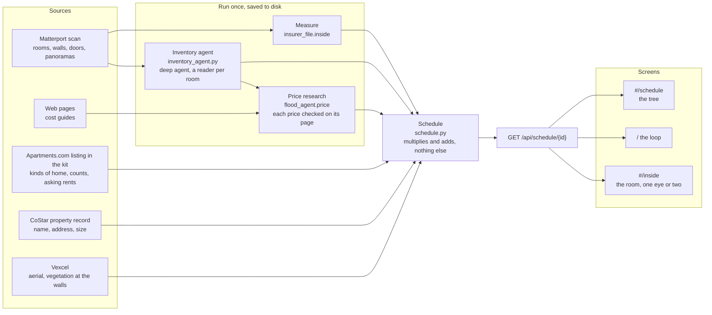
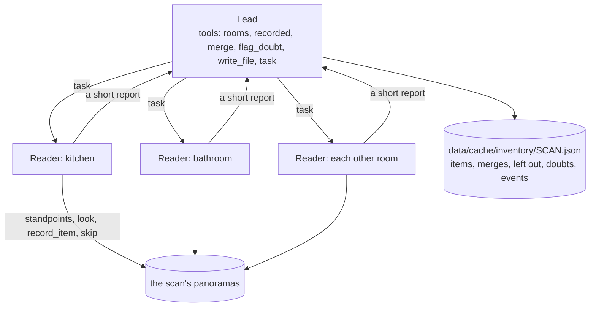
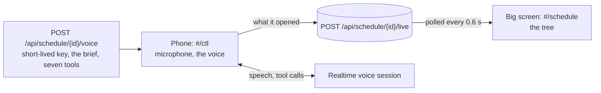

# Brace: architecture

As built on Saturday 14 November 2026, 19:30. The product is in `PRD.md`; the two-minute loop is in
`DEMO_LOOP.md`. Anything not built yet is under "Not built yet" at the end and nowhere else.

**What the system does:** it turns the leasing scan of one apartment home into a priced list of what the owner
would have to replace after a fire, then multiplies that list across the kinds of home the community has.

## The whole thing on one page



Models run only in the middle column, ahead of time. Nothing on a screen waits on a model, with two exceptions the
owner asks for: "Look again" (the agent reads one room a second time) and "Find the make and model" (one item is
matched to products). Each takes a minute or two.

## Where each number comes from

| Number | Source | Code |
| --- | --- | --- |
| Floor area, wall length, ceiling height, door count | Matterport's measurements of the scan | `backend/insurer_file.py` (`inside`), `backend/openings.py` |
| What fit-out is in each room, and how many | The inventory agent, looking at the scan's panoramas | `backend/inventory_agent.py` |
| A price range for each kind of line | A web page, kept only when a fetch of the page finds the price and the sentence | `backend/flood_agent.py` (`price`, `confirm`) |
| Kinds of home, how many of each, asking rents | The community's Apartments.com listing, as it stands in the kit | `backend/portfolio.py` (`floor_plans`, `rent`) |
| Vegetation within 5 ft of each building's walls, tree cover over its roof | Vexcel | the saved building file, read in `backend/exposure.py` |
| The fire hazard severity zone at each building | CAL FIRE's map, saved on disk | `backend/exposure.py` (`zone_at`) |
| The order of the buildings | Zone, then vegetation at the walls, then tree cover over the roof. An ordering, not a score | `backend/exposure.py` |
| What the runs cost | Tokens each saved run recorded, times the published price for its model. Web search fees are not counted | `backend/run_cost.py` |
| Every total | Arithmetic in code | `backend/schedule.py` |

## Listings: what Apartments.com and Homes.com are used for

Both are CoStar sites and both are already in the kit as files; nothing is scraped.

- **Apartments.com** (`data/apartment-listing.jsonl`): each community's floor plans with bedrooms, bathrooms,
  size, a count of homes and asking rents. This sets the multiplication and the lost rent. It replaced the property
  record's single unit count, which for the lead property is about double what the listing describes and more than
  the building's recorded floor area can hold.
- **Homes.com** (`residential-listings.csv`): links about 2,200 houses for sale or rent to a Matterport scan. Not
  used. It would matter if the customer were a homeowner, which the team decided against.

Neither is used to value what is inside a home. A listing price or a rent is a market figure and includes land and
location. What an owner has to replace is a rebuilding cost, which is why the item prices come from cost guides.

## How an item gets a value

There is no trained classifier. The step that names things is a vision-language model working inside the
inventory agent, held to a fixed list:

1. **Name.** A reader looks at one panorama face at a time and may record only the 23 kinds in
   `inventory_agent.KINDS` (refrigerator, base cabinet, toilet, ceiling fan and so on). Anything else, including
   all furniture, is refused by the tool. What it saw and chose to leave out, it notes with a reason.
2. **Count and place.** It records how many and where in the picture, which the tool turns into a direction from
   the standpoint, so the item can be pointed at later.
3. **Price the kind.** The price research is given the kinds that were named and finds a stated installed price
   range for each. `confirm` fetches the page and keeps the price only if the price and the sentence are on it.
4. **Multiply.** `schedule.py` multiplies count by price range. A kind with no confirmed price has null money.

So the value is a range for the kind of thing, not an appraisal of that particular refrigerator. The ranges are
national cost-guide figures and some are wide. Where an item has been matched to products (see "Find the model"),
its line uses those products' listed prices instead.

## The inventory agent

Built on LangChain's `deepagents` (`create_deep_agent`).



- The lead lists the rooms the camera stood in and sends them all out at once.
- A reader has its own context. It calls `look(room, standpoint, direction)` and is shown that picture, then
  `record_item` for what it sees. A whole home is about 60 pictures, which is why each room gets its own context.
- The lead reads back what was recorded, merges the same thing seen twice, writes `/inventory.md`, and states what
  no reader could see.

Held in code, not in the prompt:

- `record_item` refuses a view nobody has looked at (no sighting, no item).
- `record_item` refuses any kind not in `KINDS`.
- `merge` refuses to merge two different kinds.
- `skip` takes one of four reasons and nothing else: furniture or a tenant's own, belongs to another room, could
  not see it well enough, already recorded from another standpoint.
- No tool measures, prices or totals.

## What the agent decides, and what the owner can ask it to do

A list of things with prices is a lookup. What makes this an agent is the judgement around the list, and that
judgement is saved with the run and shown under each room on `#/schedule` and beside the room in the loop.

| Decision | Tool | On the lead home |
| --- | --- | --- |
| This is not the owner's, or is another room's, or cannot be seen well enough: leave it out and say why | `skip` (reader) | 15 left out |
| These two records are the same thing seen from two rooms: keep one | `merge` (lead) | 2 merged |
| This count may be wrong, and here is why | `flag_doubt` (lead) | 11 doubts |

Three things the owner can ask for, by a button or by voice:

- **Look again** (`POST /api/schedule/{id}/recheck?room=`, `inventory_agent.recheck`). The agent reads one room a
  second time with its own doubts in front of it. That room's lines are replaced by what it finds, the schedule is
  rebuilt and the screen says what changed. Run on the lead home's kitchen: it recorded the pantry cabinet it had
  left out and took the base cabinets from 2 to 1.
- **Check my cover** (`POST /api/schedule/{id}/cover?amount=`, `backend/cover.py`). The cover the owner carries
  for the fit-out is compared with the schedule under the usual coinsurance clause at 80%, with a worked example
  of what a claim would pay, and a note to the broker is drafted on the screen. Nothing is sent. It is arithmetic,
  not advice, and it compares fit-out with fit-out: a figure for the whole building would flatter the owner.
- **Find the model** (`POST /api/schedule/{id}/match?room=&item=`, `backend/product_match.py`). A prototype. One
  model run is shown the picture an item was recorded in, a close-up round it and the room from one other
  standpoint, says what is visible, and searches for up to three products sold today that look like it. The rules
  are in code: a product is kept only when a fetch of its page holds its price and model number
  (`flood_agent.confirm`); the line's range becomes the lowest to the highest kept price; with none kept the line
  keeps its cost-guide price; the label is "Brand read from the scan" only when the model read a brand in the
  picture and a kept product is that brand, otherwise "Closest match". It is never an identification. Matches are
  saved in `data/cache/inventory/<scan>.matches.json` under `<room_id>:<kind>`, and
  `GET /api/schedule/{id}/view.jpg?room=&item=` serves the close-up.

## The schedule

`schedule.schedule(property_id)` returns one tree, served at `GET /api/schedule/{property_id}`:

```
property           total, homes counted, homes on the record, rent per month
  kinds_of_home    one row per floor plan: homes, figure per home, how it was reached
  buildings        ranked by vegetation at the walls; a share of the homes by roof area
    units          the scanned home, under the building it sits in
      rooms        a total for each, and whether the camera stood in it
        items      what, quantity, unit, read or measured, price range, page, where it was seen
```

The multiplication, in order:

1. One home: sum of its lines. Fit-out lines are count times price; building-work lines (flooring, drywall,
   painting, baseboard, doors) are a measured quantity times price.
2. Kinds of home: the floor plan that matches the scanned home's bedrooms and bathrooms takes that figure. A plan
   that was not scanned takes it scaled by floor area and says so. With no listing, every home on the record is
   taken to be like the scanned one.
3. Property: the sum over kinds of home.
4. Buildings: the homes are shared by roof area in whole numbers that add up, because no source counts homes per
   building. A building's figure is its share times the average home.
5. Rent: each kind of home's count times its asking rent.

Rules that hold everywhere:

- Money that is not known is null, never zero, and is left out of totals. Each total carries its count of priced lines.
- Every extrapolation is marked as one, in the data and on the screen.
- A total leads with one figure: the middle of every line's range, added up (`middle`). Beside it is a likely band
  (`likely_low`, `likely_high`), which is the root of the sum of the squares of the lines' own spreads, lines of one
  kind taken together first (`schedule._band`). It assumes lines priced from different pages are off independently.
  It does not cover anything that moves every price together (Los Angeles labour against national guides) or the
  other homes differing from the scanned one. The two ends (`low`, `high`: every line at its low or its high) are
  kept and shown under "How this is worked out". Lines and rooms still show their own ranges.
- The scenario is stated ("fire reaches the building"), never forecast.

## Other endpoints

- `GET /api/exposure/{property_id}`: each building with its three facts, its place in the order, and the sources.
- `GET /api/schedule`: the scanned Los Angeles apartment communities inside a mapped fire zone. A community whose
  scan has been read ranks first, by its total; the rest rank by asking rent per month from the listing. A community
  with no listing has null homes and rent and comes last.

## Talking to it, and the phone

The schedule is not driven by a chat box. It is spoken to, and it answers by opening things on the screen.



- The voice layer already existed for the preparation product (`frontend/src/voice.ts`, `conversation.ts`,
  `backend/voice.py`). The schedule registers itself with it as a stage: a brief and seven tools.
- The brief (`voice.schedule_instructions`) is built from the schedule and nothing else: the total, how it was
  multiplied, the ranking, the rooms, what the agent left out and what it is unsure of. The voice is told to say
  only that and what a tool returns.
- The tools run in the browser against the schedule already loaded: `open_building`, `open_room`,
  `explain_line`, `show_working`. Each moves the screen and returns the figures it is now showing. Three more ask
  the server to act: `look_again` (the second look at a room), `find_model` (a product matched to one item; with
  `look_again`, the only things that can change a figure) and `check_cover`. None sends anything or books anything.
- `#/ctl` is the same schedule on a phone. It shows the name, the figure and the conversation; whatever a tool
  opens is posted to the server, and `#/schedule` on the big screen follows. The "Phone" button on the big screen
  shows a QR code for it. The phone needs the HTTPS server on the local network for its microphone.
- Typing is the fallback: shift-click "Talk with Brace" to start without a microphone, then `/` to type.

## Files

```
backend/
  inventory_agent.py   the deep agent: lead, readers, tools, rules                     (new, 14 Nov)
  schedule.py          the tree and its arithmetic; communities(), the portfolio list   (new, 14 Nov)
  exposure.py          each building's three facts and the order they put it in         (new, 14 Nov)
  run_cost.py          what the saved runs cost, from their own token counts            (new, 14 Nov)
  cover.py             the owner's cover against the schedule; the draft note           (new, 14 Nov)
  product_match.py     a likely make and model for one item, with a tighter price       (new, 14 Nov, prototype)
  flood_agent.py       price research with web search and page fetch; confirm()
  insurer_file.py      quantities from a scan; the one-home schedule under a flood depth
  openings.py          Matterport's wall and opening measurements
  portfolio.py         CoStar records; Apartments.com floor plans and rents
  flood.py             site(): buildings, outlines, vegetation, from the kit and Vexcel
  matterport.py        scan metadata and panorama faces
  vision.py            image blocks for a model
  server.py            the API
scripts/
  inventory.py         run the inventory agent, then --prices
  flood_research.py    price the building work
frontend/src/story/
  ScheduleTree.tsx     #/schedule: the tree
  Loop.tsx             / : the loop, from Los Angeles down to the items in one home
  Home.tsx             / : the window and the cloud above the loop
  InsurerFile.tsx      #/file: one home's schedule under a flood depth
  InsidePov.tsx        #/inside, #/inside/vr: the room from where a person stands
tests/
  test_inventory_schedule.py, test_inventory_decisions.py, test_product_match.py, test_cover.py, test_insurer_file.py, test_flood_agent.py,
  test_exposure.py, test_schedule_portfolio.py, test_run_cost.py
```

Saved runs, never committed: `data/cache/inventory/<scan>.json` (the inventory),
`data/cache/inventory/prices.json` (fit-out prices), `data/cache/flood/prices.json` (building-work prices).

## Running it

```
python -m scripts.flood_research --prices <property> <scan>   # building work, once
python -m scripts.inventory <property> <scan>                  # read the scan (about 100 seconds for one home)
python -m scripts.inventory <property> <scan> --prices         # price what has no price yet (about 3 minutes from nothing)
python -m scripts.start                                         # API and web servers
```

Then `http://localhost:5174/#/schedule` (or the port it prints; the lead property) or `#/schedule/<property>`.

The lead home's run: 6 rooms, 60 views, 32 items named, 21 kinds of line priced and confirmed; 2 merges, 15 things
left out with a reason, 11 doubts flagged; the kitchen read a second time.

## Not built yet

| What | Who | Note |
| --- | --- | --- |
| The portfolio list on a screen (the loop's last beat) | nobody yet | The data is served: `GET /api/schedule` lists the scanned Los Angeles communities inside a zone, ranked. The loop ends on the property figure |
| A grade for each item (basic, mid, high) to narrow its price range | nobody yet | Would cut the width of the total |
| More than one scanned home per property | nobody yet | The lead property has one scan |

## Still in the repo, not in the pitch

The storm and wildfire preparation product (`agent.py`, `desk_agent.py`, `screen.py`, the resident pages), the
flood stress test (`flood.py`'s `test`, `#/flood`) and the earlier scroll scenarios. They share the data layer
with the schedule and are left in place.
