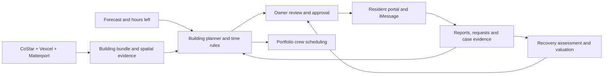

# Brace

**The forecast sets the clock. The building shapes the response.**

Brace helps residents and property teams prepare for a disaster, respond to reports, and organize recovery. It combines CoStar property information, Vexcel aerial data, Matterport interiors, and public weather forecasts for the same address.

The central question is simple: **what can we still do for the people in this building, with the time and resources left?**

Built for the CoStar track at HackPrinceton 2026. This README describes the current implementation and labels the next work separately. Start here; older planning documents may describe an earlier stage.

## The experience

1. **A forecast starts the clock.** Brace finds affected properties in Houston or Los Angeles and shows the forecast, building facts, and hours until conditions arrive.
2. **The agent investigates the building.** It reads records, examines aerial and interior images, and uses available measurements to propose work with a location, crew, duration, cost range, and supporting evidence.
3. **The clock constrains the work.** A proposed task must fit before the crew cutoff. As the forecast advances, the agent must split work or move it until after the event.
4. **The owner approves the communication.** A notice can be published to selected households. Connected residents receive it through their private portal and iMessage.
5. **Residents report what is happening or ask for help.** Reports appear in the owner's case and site feed. A description can be matched to a scanned room or fixture; a scan check shows what the historical record supports.
6. **The response changes.** Rebuilding the building plan includes the case's resident reports. The owner can review evidence, run a recovery assessment, manage tasks, and send a household-specific update.
7. **Recovery gets a financial record.** The assessment keeps repair scope, comparable evidence, costs, downtime, and valuation assumptions together. A report alone does not create a dollar loss.

A report is an observation that deserves a response. A historical scan helps locate and contextualize it; it cannot prove that new damage did or did not happen.

## What is implemented

| Area | Current behavior |
|---|---|
| Forecasts | Hurricane Beryl 2024 and January 2025 Los Angeles fire-weather replays, plus live forecast support. Historical steps retain their issue times. |
| Building planning | A Claude tool loop inspects evidence, opens and resolves leads, writes located actions, and drafts resident notices and work orders. |
| Time rules | Before-arrival work must fit within forecast hours remaining minus a six-hour crew stand-down. This is an application policy, not an official emergency instruction. |
| Portfolio coordination | The storm desk compares saved building plans and assigns scarce trades within working windows. It can compare additional crews and record owner decisions. It does not book contractors. |
| Resident communication | Owner-managed households, private invitations, resident reports and photos, support requests, approved notices, and owner follow-ups. Photon connects linked iMessage conversations when configured. |
| Report checks | Matches descriptions to indexed rooms/fixtures and returns `fits`, `wrong_place`, or `cannot_tell`. These describe consistency with the scan index, not damage severity or resident honesty. An optional vision pass describes the historical view. |
| Recovery and value | Case-scoped evidence, assessments, tasks, comparable screening, repair/disruption calculations, and conditional valuation with explicit inputs. |
| Spatial work | Scan-to-roof fitting, aerial surface/terrain measurements, indexed interior search, and sourced site models. Coverage depends on which properties have been prepared. |
| Navigation and interaction | Matterport viewing, synchronized phone headset views, optional voice, and scan-based wayfinding with wheelchair constraints. Routes describe recorded geometry, not current emergency clearance. |
| Room exploration | Views of a room as scanned, cleared, and furnished again; optional generated 3D furniture. These are design explorations, not evidence of completed repairs. |
| CoStar market context | Recorded sale information and Apartments.com community asking rents/availability alongside the building. Asking rents are not collected income. |

The local Houston phone loop has been exercised with a resident report, its placement in a representative scan, and a subsequent building-plan run that retained the report's identity. That does not establish the resident's exact unit or automatically complete a recovery assessment.

## How the data fits together

| Source | What it contributes |
|---|---|
| CoStar property records | Building identity, location, construction, unit mix, managers, business occupancies, and sale evidence. Business tenants are not a household roster. |
| Apartments.com listings in the kit | Community and floor-plan asking rents, reported units available, bedrooms, bathrooms, sizes, and management-company references. |
| Homes.com listings in the kit | Residential sale/rental records, listing status, home features, listing contacts, and associated Matterport media. Housing matching is planned below. |
| Vexcel | Aerial imagery, structure outlines, roof/grounds attributes, and available surface and terrain data. |
| Matterport | Scanned interiors, rooms, sweep positions, imagery, floor plans, and available geometry. Some scans represent model units. |
| Public hazard sources | Forecasts, warnings, standing flood/fire information, and available observed rainfall. |

Evidence retains its source and, where available, capture or issue date. Different layers can describe different dates. Fitting a scan beneath a roof does not necessarily establish its exact position along that roof or identify a resident's unit.

The kit includes 3,339 commercial properties, 1,747 apartment-community listings, and 2,120 residential listing records. The residential records include sales and closed listings: only 26 records, representing 25 homes, are active rentals in this snapshot.

## Next: housing and relocation

The next product extension is **helping a displaced household find suitable accommodation while its home is repaired**. This is planned; Brace does not currently match or reserve replacement housing.

The intended loop is:

- Collect dates, household size, budget, pets, mobility requirements, and transport needs.
- Search Apartments.com floor plans and Homes.com rental homes; deduplicate and filter by listing status.
- Screen candidate addresses against the incident and inspect relevant layouts where scans exist.
- Ask the provider to confirm actual availability, lease duration, access requirements, and full price.
- Track provider confirmation, resident acceptance, placement, and extensions as repair dates change.
- Allocate limited confirmed options across households without assigning the same unit twice.

The listing snapshot is from November 2026. It is not live booking inventory or evidence of availability during a 2024 or 2025 event. Reported vacancies do not establish short-stay terms, current condition, or immediate move-in readiness.

## Current gaps to know about

- **Replanning is explicit.** A resident report is included when the building plan is rebuilt; it does not yet trigger a fully automatic, incremental replan across every workflow.
- **The two report readers need unifying.** The building planner reads recovery-case reports; the storm-desk agent currently reads the local site-report store. Do not assume every phone report reaches the portfolio agent.
- **Scheduling uses assumptions.** Travel time and working hours are fixed policies. The current scheduler's `people` field combines home and business-tenant counts; it is not a verified headcount or a measure of lives protected.
- **Location can be tentative.** A description match and a representative floor plan do not verify a household's actual unit. Missing objects in an index can reflect incomplete indexing.
- **Value needs evidence.** Missing financial inputs remain unavailable. The footprint calculator uses owner-entered damage extent and rates; it does not detect damage automatically or establish an appraisal.
- **Prepared assets matter.** Source bundles, spatial indexes, saved plans, and generated media live outside Git. A fresh clone will not contain the prepared walkthroughs.

## Run locally

Use Python 3.11+, [uv](https://docs.astral.sh/uv/), and Node 22+ if using Photon.

From the repository root:

```bash
uv sync
npm --prefix frontend ci
cp -n .env.example .env
```

The copy command keeps an existing `.env` intact.

Extract the sponsor kit so these paths exist:

```text
data/kit/index.md
data/kit/commercial-properties.csv
data/kit/residential-listings.csv
data/kit/data/commercial-property.jsonl
data/kit/data/apartment-listing.jsonl
data/kit/data/residential-listings.jsonl
```

Use your own sponsor credentials and model keys in `.env`:

| Setting | Used for |
|---|---|
| `MATTERPORT_API_KEY`, `MATTERPORT_API_TOKEN` | Fetching scan data |
| `MATTERPORT_SDK_KEY` | Embedded Matterport viewer |
| `VEXCEL_API_KEY` | Aerial imagery and site data |
| `ANTHROPIC_API_KEY` | New plans and visual analysis |
| `OPENAI_API_KEY` | Optional live voice |
| `MESHY_API_KEY` | Optional new 3D furniture generation |

Model overrides are `BRACE_AGENT_MODEL`, `BRACE_VISION_MODEL`, and `BRACE_AGENT_EFFORT`. New source fetches and model runs can incur provider usage; saved results are reused where available.

Prepare the baseline data, then start:

```bash
uv run python -m scripts.scan_parcels
uv run python -m scripts.fetch_hazards
uv run python -m scripts.start
```

The single start command runs the API, desktop web app, HTTPS phone app, and Photon worker when configured. Ctrl-C stops them together.

- Desktop: **http://localhost:5174**
- API: **http://127.0.0.1:8001**
- Phone: **https://YOUR-LAN-IP:5175** — the start command prints the address.

The supplied Matterport SDK configuration requires `localhost` for the desktop viewer. For phones, use the same network and accept the local certificate once. If the network isolates devices, connect the computer through the phone's hotspot.

To choose other ports, pass them in the shell:

```bash
BRACE_API_PORT=8011 BRACE_WEB_PORT=5184 BRACE_VR_PORT=5185 uv run python -m scripts.start
```

### Where to go

The home page lists four scrolling experiences: **Before the storm**, **Five buildings, two crews**, **After the storm**, and **The way out**. Their routes are `#/story/storm`, `#/story/desk`, `#/story/after`, and `#/story/inside`.

Operational views are also available:

| Route | Purpose |
|---|---|
| `#/beryl-2024/adv33` | Houston portfolio at an earlier forecast step |
| `#/beryl-2024/adv37/b/4303509` | The Parker at Ellington at a later forecast step |
| `#/la-red-flag-jan-2025` | Los Angeles fire-weather scenario |
| `#/model` | Prepared site models |
| `#/recovery` | Owner recovery cases |
| `#/resident` | Resident portal; first access requires a private invitation |

## Enable recovery and resident messaging

Add these settings to `.env` for local owner access:

```dotenv
BRACE_RECOVERY_ENABLED=1
BRACE_LOCAL_OWNER=1
BRACE_ALLOWED_ORIGINS=http://localhost:5174,http://127.0.0.1:5174
```

Local-owner mode opens the owner workspace directly on this computer's loopback browser. For owner sign-in elsewhere, set a private `BRACE_OWNER_SECRET`. Add the exact HTTPS phone origin to `BRACE_ALLOWED_ORIGINS`; update desktop origins if using different ports.

Recovery needs a registered case. Generate a source run using `scripts.recovery` (see `--help` for incident dates, assessment date, source fetching, and model options), then stop the server and import the returned run directory:

```bash
uv run python -m scripts.recovery --help
uv run python -m scripts.import_recovery_case data/recovery/CASE_ID/RUN_ID
```

Restart, open `#/recovery`, add a household, and create its private invitation. Household creation does not verify a unit or scan association. Use one API process with the local store.

To connect preparation notices and reports to that case, set the explicit mapping:

```dotenv
BRACE_PREPARATION_CASES={"4303509:beryl-2024":"YOUR_CASE_ID"}
```

For iMessage:

```bash
npm --prefix messaging/photon ci
```

Set `PHOTON_PROJECT_ID`, `PHOTON_PROJECT_SECRET`, and a private `BRACE_PHOTON_BRIDGE_SECRET`. The Photon dashboard calls the first two values Spectrum project credentials; Brace expects the `PHOTON_` variable names. The start command supplies the bridge URL for its API port.

A resident must link their conversation to their household. Publishing an approved notice queues delivery to connected households; owner responses to support requests can return to that same conversation. Queued delivery and confirmed delivery are different states.

## Useful commands

Prepare plans for the chosen forecast steps:

```bash
uv run python -m scripts.plan --list
uv run python -m scripts.plan --scenario beryl-2024 --step adv33 4303509
uv run python -m scripts.plan --scenario beryl-2024 --step adv37 4303509
uv run python -m scripts.desk --scenario beryl-2024 --step adv37 --schedule-only
```

Spatial preparation is separate: `scripts.open_geolocation` fits scans to roofs, `scripts.open_reconstruct` gathers surface measurements, and `scripts.open_search` builds the interior search index. Run each with `--help`; they need appropriate source bundles and some operations use paid APIs.

Checks:

```bash
uv run pytest
npm --prefix frontend run build
npm --prefix frontend run test:recovery
npm --prefix frontend run test:resident
npm --prefix messaging/photon run selftest
```

## Code map



| Location | Responsibility |
|---|---|
| `backend/agent.py`, `backend/clock.py` | Building planning and deadline checks |
| `backend/hazards/`, `backend/screen.py` | Forecasts and portfolio screening |
| `backend/site_model.py`, `backend/report_check.py` | Spatial evidence, report placement, historical scan checks |
| `backend/openproblems/`, `backend/wayfind.py` | Spatial analysis, room exploration, navigation |
| `backend/desk.py`, `backend/desk_agent.py` | Crew scheduling and portfolio agent |
| `backend/recovery/domain/` | Recovery reasoning, comparables, costs, valuation |
| `backend/recovery/platform/` | Cases, households, invitations, reports, tasks, persistence |
| `backend/recovery/photon.py`, `messaging/photon/` | Messaging bridge and Spectrum worker |
| `frontend/src/story/` | Scrolling scenario experiences |
| `frontend/src/components/`, `frontend/src/recovery/` | Building, owner, resident, spatial and headset views |

For deeper implementation details, see [recovery-core.md](docs/recovery-core.md) and the [shared contract](docs/recovery-handoffs/05-SHARED-CONTRACT.md). [HANDOFF.md](HANDOFF.md), [PRD.md](PRD.md), and the [original team split](docs/recovery-handoffs/00-START-HERE.md) explain earlier decisions; their status lists can lag behind the code.

Development is on **main**. Keep changes focused so parallel work can be integrated without replacing another contributor's changes. The sponsor kit, cached imagery, resident data, `.env`, and credentials remain local and are not committed.
