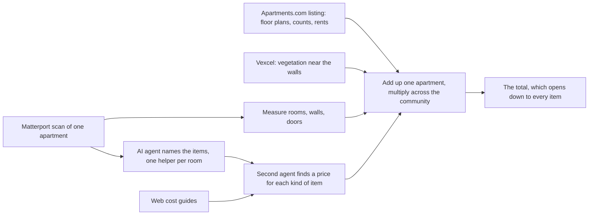

# Brace

**If a wildfire burned an apartment building, what would the owner have to pay to replace everything inside it? Brace answers that with an itemised, priced list, built from a 3D scan the owner already has.**

Built at HackPrinceton Fall 2026 for the CoStar track ("Inside and Out: AI for the Built World"), with the Business and Enterprise and LangChain tracks.

## The problem

The owner of an apartment community insures the buildings and everything built into them: floors, cabinets, counters, appliances, doors, light fixtures. To buy that insurance they have to tell the insurer what it would all cost to replace. Most owners have no list of what is actually in their apartments, so they estimate from a rough cost per square foot. If the estimate is too low, a fire leaves them paying the difference.

## The idea

Most apartment communities already have a 3D walkthrough of a model apartment, made with a Matterport camera so renters can tour it online. That scan shows every room and everything in it. Nobody uses it for insurance.

Brace reads that scan and turns it into the missing list:

1. **Look through the scan, room by room,** and name each thing the owner would have to replace: one refrigerator, twelve feet of base cabinets, two ceiling fans.
2. **Measure the rooms** for the floors, walls, paint and doors.
3. **Find a price for each kind of item** on the web, and keep the price only if the page really says it.
4. **Add it up for one apartment, then multiply** across all the apartments like it in the community.

The result is one total with everything behind it. You can open the total into buildings, a building into apartments, an apartment into rooms, a room into items, and an item into the web page its price came from.

Brace does not predict fires. It answers one stated question: *if fire reached this building, what would it cost to replace what is inside?*

## Where the data comes from

Three datasets from the hackathon's sponsor kit, plus the web:

| Source | What it is | What Brace takes from it |
|---|---|---|
| **Matterport** | 3D scans of building interiors | The rooms, their measurements, and photos from every spot the camera stood |
| **Vexcel** | Aerial photos and measurements of buildings from above | How much vegetation grows close to each building's walls |
| **CoStar / Apartments.com** | Property records and apartment listings | How many apartments the community has, their floor plans, and the advertised rents |
| **Web cost guides** | Public pages that state what things cost to install | A price range for each kind of item |

## Words this project uses

| Term | Meaning |
|---|---|
| **Put back** | Replace or rebuild after a loss. "What a fire would cost to put back" means the cost to replace what burned |
| **Fit-out** | Everything built into an apartment that the owner owns: flooring, cabinets, counters, appliances, doors, fixtures. Not furniture, and not anything belonging to a tenant |
| **Leasing scan** | The 3D walkthrough of an apartment made to advertise it to renters |
| **Schedule** | The itemised, priced list. It is the insurance word for a list of what is insured and its value |
| **Fuel at the wall** | Plants that can burn (brush, shrubs, trees) growing within 5 feet of a building's walls. Not a gas line. Wildfires usually reach a building through vegetation touching it, so buildings with more of it are more exposed |
| **Kinds of home** | The community's floor plans, such as one-bedroom and two-bedroom |
| **Lost rent** | The rent the owner stops collecting while burned apartments cannot be lived in |

## How it works



- **Naming the items.** An AI agent built on LangChain's `deepagents` gives each room to its own helper. The helper looks at that room's photos and records what it sees. It may only record 23 kinds of item that an owner owns. The code refuses furniture, and refuses any item recorded from a photo the helper never looked at.
- **Pricing.** A second agent searches the web for what each kind of item costs to install. The code then fetches the page itself and keeps the price only if the price is really on it.
- **Adding up.** Plain code does all the arithmetic. No AI model touches a total.
- **Ranking buildings.** Buildings are ordered by their official fire hazard zone (from CAL FIRE's map), then by how much vegetation grows within 5 feet of their walls, then by how much of the roof is under trees.

The AI steps run ahead of time and their results are saved. The screens only read saved results, so nothing waits on a model.

## How far to trust the numbers

- **Prices are ranges for a kind of item**, such as "a refrigerator, installed", taken from national cost guides. They are not a valuation of the specific refrigerator in the scan, and some ranges are wide.
- **One apartment was scanned; the rest are estimated from it.** A floor plan with the same bedrooms and bathrooms gets the same figure. A different floor plan gets the figure scaled by its floor area. The screen marks these as estimates.
- **An item with no confirmed price shows no figure** and is left out of the total. Each total says how many of its lines are priced.
- **Apartments per building are estimated from roof area**, because no source counts them per building.
- **The building ranking is about exposure, not the chance of a fire.** It orders buildings by official fire zone, then vegetation near the walls, then tree cover over the roof.
- **Advertised rents are not what tenants actually pay.**
- **The scans are sample data from the sponsor kit**, not a real customer's insured property.

## What is built

| Piece | What it does |
|---|---|
| Inventory agent | Reads a scanned apartment and saves the list of items it found |
| Price research | Finds and confirms a price range for each kind of item |
| Schedule | Builds the full list for a property, with totals at every level and lost rent per month. Served at `GET /api/schedule/{property_id}` |
| Exposure rank | Orders a property's buildings by fire zone, vegetation near the walls and tree cover over the roof. Served at `GET /api/exposure/{property_id}` |
| Portfolio list | Lists the scanned Los Angeles apartment communities inside a fire zone, ranked. Served at `GET /api/schedule` |
| Run cost | Works out what the AI runs cost from the tokens they recorded, and shows it with the other run figures |
| Tree screen (`#/schedule`) | The total at the top; click down through building, apartment, room and item to the source page |
| Voice | You can ask the schedule questions out loud. It answers by opening the relevant part of the screen. It cannot change a figure |
| Phone as microphone (`#/ctl`) | The same screen on a phone. The big screen follows whatever the phone opens |
| One apartment under water (`#/file`) | The same kind of list for a flood of a chosen depth, as an example of a partial loss |
| First-person room (`#/inside`, `#/inside/vr`) | The room as seen by a person standing in it, on a screen or in a phone headset |

Not built yet: a screen for the portfolio list, the home-page walkthrough for Los Angeles (`/` still plays an earlier Houston flood sequence), labels drawn on the items inside the scan, narrowing price ranges by item quality, and scanning more than one apartment per property.

For more detail:

| Document | What it holds |
|---|---|
| [ARCHITECTURE.md](ARCHITECTURE.md) | How the system is put together and where each number comes from |
| [DEMO_LOOP.md](DEMO_LOOP.md) | The two-minute demo, step by step, and the decisions the team has settled |
| [PRD.md](PRD.md) | Requirements and who builds what |

Brace began the hackathon as a different product, a tool for preparing buildings and residents for a storm. The team changed direction on 14 November 2026. That earlier code still works and is described under [Earlier work still in the repo](#earlier-work-still-in-the-repo).

## Run locally

Use Python 3.11+, [uv](https://docs.astral.sh/uv/), and Node 22+ if using Photon.

From the repository root:

```bash
uv sync
npm --prefix frontend ci
cp -n .env.example .env
```

The copy command keeps an existing `.env` intact.

Extract the sponsor kit so these paths exist:

```text
data/kit/index.md
data/kit/commercial-properties.csv
data/kit/residential-listings.csv
data/kit/data/commercial-property.jsonl
data/kit/data/apartment-listing.jsonl
data/kit/data/residential-listings.jsonl
```

Use your own sponsor credentials and model keys in `.env`:

| Setting | Used for |
|---|---|
| `MATTERPORT_API_KEY`, `MATTERPORT_API_TOKEN` | Fetching scan data |
| `MATTERPORT_SDK_KEY` | Embedded Matterport viewer |
| `VEXCEL_API_KEY` | Aerial imagery and site data |
| `ANTHROPIC_API_KEY` | The inventory agent, price research, plans and visual analysis |
| `OPENAI_API_KEY` | Optional voice |
| `MESHY_API_KEY` | Optional new 3D furniture generation |

Model overrides are `BRACE_AGENT_MODEL`, `BRACE_VISION_MODEL`, `BRACE_AGENT_EFFORT`, `BRACE_VOICE_MODEL` and `BRACE_VOICE`. New source fetches and model runs can incur provider usage; saved results are reused where available.

### Build a schedule

The demo property is a Los Angeles apartment community, CoStar ID `9519837`, with Matterport scan `CaSLe7ZwnfF`. Its building data and the scan's room measurements must already be downloaded into `data/cache/`.

```bash
uv run python -m scripts.flood_research --prices 9519837 CaSLe7ZwnfF   # price the building work, once
uv run python -m scripts.inventory 9519837 CaSLe7ZwnfF                 # read the scan, about 80 seconds for one home
uv run python -m scripts.inventory 9519837 CaSLe7ZwnfF --prices        # price what it named, about 3 minutes
```

Add `--only kitchen-1 --dry` to the inventory command for a short run that saves nothing.

Saved runs live in `data/cache/inventory/` and `data/cache/flood/` and are never committed. A fresh clone has none, and the schedule endpoint answers 404 until a scan has been read.

### Start

```bash
uv run python -m scripts.start
```

The single start command runs the API, desktop web app, HTTPS phone app, and Photon worker when configured. Ctrl-C stops them together.

- Desktop: **http://localhost:5174**
- API: **http://127.0.0.1:8001**
- Phone: **https://YOUR-LAN-IP:5175** — the start command prints the address.

The supplied Matterport SDK configuration requires `localhost` for the desktop viewer. For phones, use the same network and accept the local certificate once. If the network isolates devices, connect the computer through the phone's hotspot. The phone's microphone needs the HTTPS address.

To choose other ports, pass them in the shell:

```bash
BRACE_API_PORT=8011 BRACE_WEB_PORT=5184 BRACE_VR_PORT=5185 uv run python -m scripts.start
```

### Where to go

| Route | Purpose |
|---|---|
| `#/schedule` | The tree for the lead property. `#/schedule/<property>` for another |
| `#/ctl` | The same schedule on a phone, as the microphone. The "Phone" button on the big screen shows a QR code for it |
| `#/file` | One home's schedule under a flood depth. `#/file/<property>/<scan>` for another |
| `#/inside`, `#/inside/vr` | The room from where a person stands, for one eye or two |
| `/` | The scroll-played 2.5D site. Today it plays the Houston flood |

To talk to the schedule without a microphone, shift-click "Talk with Brace", then press `/` to type.

## Checks

```bash
uv run pytest
npm --prefix frontend run build
npm --prefix frontend run test:recovery
npm --prefix frontend run test:resident
npm --prefix messaging/photon run selftest
```

## Code map

| Location | Responsibility |
|---|---|
| `backend/inventory_agent.py` | The deep agent: lead, readers, tools and the rules held in code |
| `backend/schedule.py` | The tree and all its arithmetic |
| `backend/flood_agent.py` | Price research with web search and page fetch; `confirm()` |
| `backend/insurer_file.py`, `backend/openings.py` | Quantities measured from a scan; the one-home schedule under a flood depth |
| `backend/portfolio.py` | CoStar records; Apartments.com floor plans and rents |
| `backend/exposure.py` | Each building's fire zone, vegetation and tree cover, and the order they put it in |
| `backend/run_cost.py` | What the saved runs cost, from their own token counts |
| `backend/flood.py` | Buildings, outlines and vegetation, from the kit and Vexcel |
| `backend/voice.py` | The voice session and what it is told about a schedule |
| `backend/server.py` | The API |
| `scripts/inventory.py`, `scripts/flood_research.py` | Run the inventory agent and the price research |
| `frontend/src/story/` | `ScheduleTree.tsx`, `Home.tsx`, `InsurerFile.tsx`, `InsidePov.tsx`, and the earlier scroll scenarios |
| `tests/test_inventory_schedule.py`, `tests/test_insurer_file.py`, `tests/test_flood_agent.py` | Tests for the new product |

## Earlier work still in the repo

Before the change of direction, Brace helped property teams prepare for a storm or fire, respond to resident reports, and organize recovery. That product is cut from the pitch. Its code shares the data layer with the schedule and is left in place.

| Area | What it does | Where |
|---|---|---|
| Forecast replays | Hurricane Beryl 2024 and January 2025 Los Angeles fire weather, plus live forecasts | `backend/hazards/`, `backend/screen.py` |
| Building planning | A Claude tool loop proposes located work that must fit before a crew cutoff | `backend/agent.py`, `backend/clock.py` |
| Portfolio coordination | Assigns scarce trades across saved building plans. It does not book contractors | `backend/desk.py`, `backend/desk_agent.py` |
| Resident communication | Households, private invitations, reports, approved notices, and iMessage through Photon | `backend/recovery/platform/`, `backend/recovery/photon.py`, `messaging/photon/` |
| Report checks | Matches a description to a scanned room. It describes consistency with the scan, not damage or honesty | `backend/site_model.py`, `backend/report_check.py` |
| Recovery and value | Case evidence, tasks, comparables, repair costs and conditional valuation | `backend/recovery/domain/` |
| Spatial work | Scan-to-roof fitting, aerial measurements, interior search, wayfinding, room exploration | `backend/openproblems/`, `backend/wayfind.py` |
| Flood stress test | A site under a chosen water depth, with researched fixes | `backend/flood.py`, `#/flood` |

Routes: `#/story/storm`, `#/story/flood`, `#/story/desk`, `#/story/after`, `#/story/fire`, `#/beryl-2024/adv33`, `#/beryl-2024/adv37/b/4303509`, `#/la-red-flag-jan-2025`, `#/model`, `#/recovery`, and `#/resident`.

Prepare its baseline data and plans with:

```bash
uv run python -m scripts.scan_parcels
uv run python -m scripts.fetch_hazards
uv run python -m scripts.plan --list
uv run python -m scripts.plan --scenario beryl-2024 --step adv37 4303509
uv run python -m scripts.desk --scenario beryl-2024 --step adv37 --schedule-only
```

Spatial preparation is separate: `scripts.open_geolocation`, `scripts.open_reconstruct` and `scripts.open_search`. Run each with `--help`; some operations use paid APIs.

### Recovery and resident messaging

Add these settings to `.env` for local owner access:

```dotenv
BRACE_RECOVERY_ENABLED=1
BRACE_LOCAL_OWNER=1
BRACE_ALLOWED_ORIGINS=http://localhost:5174,http://127.0.0.1:5174
```

Local-owner mode opens the owner workspace directly on this computer's loopback browser. For owner sign-in elsewhere, set a private `BRACE_OWNER_SECRET`. Add the exact HTTPS phone origin to `BRACE_ALLOWED_ORIGINS`.

Recovery needs a registered case. Generate a source run, then stop the server and import the returned run directory:

```bash
uv run python -m scripts.recovery --help
uv run python -m scripts.import_recovery_case data/recovery/CASE_ID/RUN_ID
```

Restart, open `#/recovery`, add a household, and create its private invitation. To connect preparation notices and reports to that case, set the mapping:

```dotenv
BRACE_PREPARATION_CASES={"4303509:beryl-2024":"YOUR_CASE_ID"}
```

For iMessage, run `npm --prefix messaging/photon ci` and set `PHOTON_PROJECT_ID`, `PHOTON_PROJECT_SECRET`, and a private `BRACE_PHOTON_BRIDGE_SECRET`. The Photon dashboard calls the first two values Spectrum project credentials. A resident must link their conversation to their household. Queued delivery and confirmed delivery are different states.

For deeper detail on this work, see [recovery-core.md](docs/recovery-core.md), the [shared contract](docs/recovery-handoffs/05-SHARED-CONTRACT.md), [HANDOFF.md](HANDOFF.md) and [DEMO.md](DEMO.md). Their status lists describe the earlier product and can lag behind the code.

## Working in this repo

Development is on **main**. Keep changes focused so parallel work can be integrated without replacing another contributor's changes. The sponsor kit, cached imagery, saved runs, resident data, `.env`, and credentials remain local and are not committed. Figures for a single property come from the data at run time and are not written into tracked documents.
